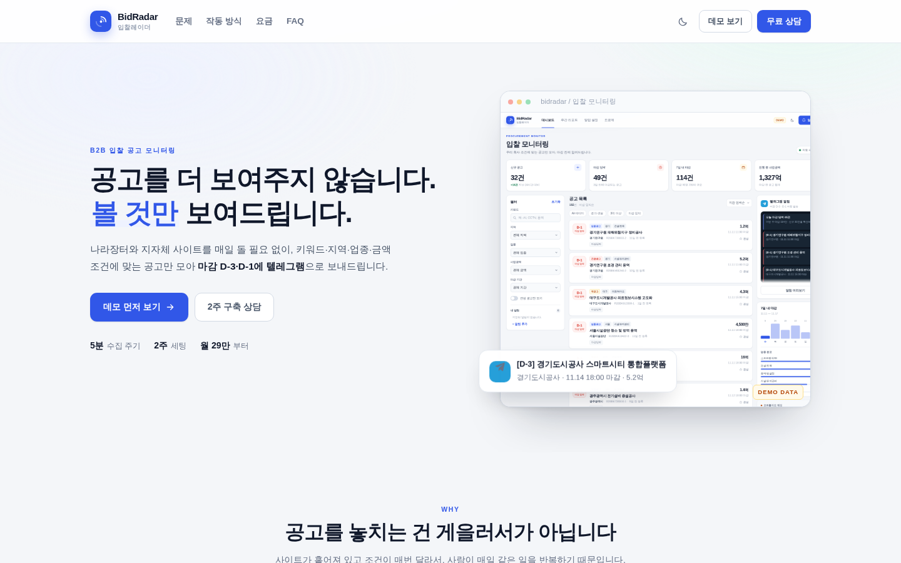

# BidRadar — 나라장터 입찰 공고 모니터링

중소기업이 매일 여러 사이트를 돌며 확인하는 입찰 공고를, **회사 조건에 맞는 것만 모아 마감 전에 디스코드로 알려주는** B2B 서비스입니다.

이 저장소에는 **영업용 랜딩페이지**, **공개 데모**, 그리고 **고객이 직접 로그인해서 쓰는 콘솔**이 함께 들어 있습니다.
Python 표준 라이브러리와 SQLite만 사용하며 빌드 단계가 없습니다.

- 랜딩: <https://bidradar-kr.duckdns.org/>
- 공개 데모: <https://bidradar-kr.duckdns.org/demo>
- 고객 로그인: <https://bidradar-kr.duckdns.org/login>
- 고객 콘솔: <https://bidradar-kr.duckdns.org/app>
- 관리자: <https://bidradar-kr.duckdns.org/admin> (Basic 인증, `.env`의 `BIDRADAR_ADMIN_PASSWORD`)

> 공고 데이터는 `BIDRADAR_SOURCE`를 따릅니다. 운영 서버는 `live`라서 `/demo`와 `/app` 모두 **나라장터 실데이터**를 보여줍니다. 로컬 기본값(`demo`)에서는 `/demo`가 가상 데이터입니다.



## 고객이 쓰는 흐름

1. 운영자가 초대 코드를 발급합니다 (`/admin` 또는 `python3 provision.py invite`).
2. 고객이 `/login` → **시작하기**에서 이메일·비밀번호·회사명·초대 코드를 입력합니다.
3. `/app/settings`에서 **알림 조건**(키워드·제외어·지역·분야·최소금액·D-3/D-1)과 **디스코드 웹훅**을 저장합니다.
4. `테스트 발송`으로 디스코드 수신을 확인합니다.
5. `/app` 대시보드는 **그 고객의 조건에 맞는 공고만** 보여줍니다. (KPI·목록·알림 패널 모두 조건 범위로 계산)
6. 매일 09:00 / 17:00(KST) `alerts.py`가 조건에 맞는 마감 임박 공고를 디스코드로 보내고, 결과를 **알림 이력**에 남깁니다.

조건이 없는 신규 계정은 전체 공고를 보여줍니다. 조건을 저장하는 순간부터 화면 숫자가 그 고객 범위로 좁혀집니다.

## 실행

```bash
cd ~/bidradar
python3 seed.py          # 데모 데이터 생성 (서버 시작 시 자동으로도 실행됨)
python3 server.py        # http://127.0.0.1:8790
```

포트/호스트 변경:

```bash
BIDRADAR_HOST=0.0.0.0 BIDRADAR_PORT=8790 python3 server.py
```

## 화면

랜딩페이지 (`/`)

- 히어로 → 문제 → 작동 방식 → 데모 미리보기 → 요금 3종 → FAQ → 상담 신청 폼
- 상담 신청은 `POST /api/lead`로 접수되어 `data/leads.db`에 저장
- 라이트/다크 테마, 모바일 반응형

공개 데모 (`/demo`)

- **KPI**: 신규 공고, 3일 내 마감, 7일 내 마감, 진행 중 사업금액
- **필터**: 키워드·지역·업종·금액·마감기간 + 관심 공고
- **공고 목록**: D-day, 발주기관, 공고번호, 금액, 마감시각, 긴급/재공고 배지
- **상세 드로어**: 사업 개요, 참가 자격, 첨부파일, 담당자
- **무JS 폴백**: 첫 화면(공고 15건·KPI·알림)은 서버에서 미리 그려서 내려줍니다. 스크립트를 막아도 빈 화면이 되지 않습니다.
- **주간 리포트**: 요일별 마감 건수, 업종 분포

고객 콘솔 (`/app`, `/app/settings`)

- 로그인 세션 쿠키(`HttpOnly`, `SameSite=Lax`) 기반. 비밀번호는 scrypt 해시로만 저장합니다.
- `/app`: 데모와 같은 화면을 쓰되 **계정 조건 범위로 서버에서 필터링**합니다. 공고 원문 링크·상세는 그대로 제공합니다.
- `/app/settings`: 디스코드 웹훅 저장·테스트 발송, 조건 추가/수정/일시중지/삭제, 최근 발송 이력, 계정 정보.
- 알림 패널은 **실제 발송 성공 이력이 있을 때만 `LIVE`**, 아니면 `PREVIEW`로 표시합니다. (거짓 LIVE 방지)

관리자 (`/admin`)

- 고객 계정 목록(플랜·상태·웹훅 유무·조건 수·발송 수), 초대 코드 발급.
- Basic 인증: 아이디 `admin`, 비밀번호는 `.env`의 `BIDRADAR_ADMIN_PASSWORD`.
- 비밀번호가 비어 있으면 `/admin`은 404를 반환합니다.

## 구조

```
seed.py               가상 공고 190건 생성 (데모 DB)
collector.py          나라장터 입찰공고정보서비스 수집 → data/live.db
accounts.py           계정·세션·조건·발송이력·초대 (SQLite, scrypt)
provision.py          운영자 CLI — 계정 생성/비밀번호 재설정/초대/목록
alerts.py             고객 조건별 마감 D-3/D-1 디스코드 알림 (DB/파일 모드)
server.py             정적 파일 + JSON API + 로그인/콘솔/관리자 (stdlib http.server)
notify.py             디스코드 웹훅/텔레그램 전송 공통 모듈
config.py             .env 로더, DB 경로, 데이터 소스·세션·가입 설정
leads.py              상담 신청 조회 CLI
backup.py             고객 계정·상담 DB 백업 (SQLite backup API)
quota.py              공공데이터 API 일일 호출 한도 관리·자동 절전
traffic.py            사이트 트래픽 급증·대역폭 감시
static/landing.html   랜딩페이지
static/landing.*      랜딩 스타일/스크립트
static/index.html     대시보드 마크업 (/demo, /app 공용)
static/app.js         필터·목록·드로어·알림·차트 (의존성 없음)
static/style.css      디자인 토큰 + 대시보드 + 반응형
static/login.html     로그인/가입 화면
static/login.js
static/settings.html  고객 알림 설정 화면
static/settings.js
static/console.css    로그인·설정·약관 화면 스타일
static/privacy.html   개인정보처리방침 (/privacy)
static/terms.html     이용약관 (/terms)
data/bids.db          SQLite (WAL) — 데모 공고
data/live.db          SQLite (WAL) — 나라장터 실데이터 (live 모드)
data/leads.db         SQLite (WAL) — 상담 신청
data/app.db           SQLite (WAL) — 고객 계정·조건·발송 이력 (백업 대상)
data/alerts.db        SQLite — 파일 모드(alerts.json) 발송 이력
docs/                 배포·제안 문서, 스크린샷
```

## API

공개:

- `GET /api/summary` — KPI, 요일별 마감, 업종 분포, 알림 미리보기
- `GET /api/bids?q=AI&region=경기&category=소프트웨어/SI&min_amount=0&days=7&sort=close&limit=15&offset=0`
- `GET /api/bid?id=bid-001` — 상세
- `GET /api/health` — 상태, 데이터 소스(demo/live), 마지막 수집 시각, 알림 채널, `bid_alerts`
- `POST /api/lead` — 상담 신청 (`company`, `name`, `contact` 필수, IP당 10분에 5건 제한)
- `POST /api/clientlog` — 브라우저 진단 로그

고객(로그인 필요):

- `POST /api/login`, `POST /api/signup`, `POST /api/logout`
- `GET /api/app/summary|bids|bid|me` — 모두 **세션 계정 범위**로 제한
- `POST /api/app/conditions`, `POST /api/app/conditions/delete`
- `POST /api/app/account` — 회사명·담당자·연락처·웹훅 저장
- `POST /api/app/test` — 디스코드 테스트 발송

관리자: `POST /admin/invite` (Basic 인증)

## 고객 계정 관리 (운영자)

```bash
cd ~/bidradar

python3 provision.py list
python3 provision.py add --email boss@acme.co.kr --company "에이스테크" --name "김대표"
python3 provision.py reset --email boss@acme.co.kr
python3 provision.py invite --note "파일럿 A사"
python3 provision.py show --email boss@acme.co.kr
python3 provision.py set --email boss@acme.co.kr --plan starter --status active
```

- 비밀번호를 생략하면 임시 비밀번호를 만들어 출력합니다. 안전한 채널로 전달하고 첫 로그인 후 변경을 안내하세요.
- `--status paused`로 계정을 잠시 막을 수 있습니다(로그인·API 차단, 발송 제외).
- 초대 가입이 기본값입니다 (`BIDRADAR_SIGNUP=invite`). 공개 가입을 열려면 `BIDRADAR_SIGNUP=open`.

## 알림 발송 (D-3 / D-1)

`alerts.py`는 **가입 고객 DB(`data/app.db`)를 우선** 사용합니다. 계정이 하나도 없으면 기존 `alerts.json` 파일 모드로 동작합니다.

```bash
python3 alerts.py --preview                 # 발송 대상 미리보기 (DB 자동 선택)
python3 alerts.py --send --all              # 활성 고객 전체 실제 발송
python3 alerts.py --send --customer acc1-c1 --stage 1
python3 alerts.py --test --customer acc1-c1 # 웹훅 테스트
python3 alerts.py --source file --preview   # alerts.json 강제
```

- 고객 id는 `acc{account_id}-c{condition_id}` 형식입니다 (`python3 provision.py list` / `show`로 확인).
- 같은 고객·조건·공고·단계는 두 번 보내지 않습니다 (`sent` 테이블).
- 웹훅이 없거나 형식이 틀리면 발송을 건너뛰고 실패 사유를 `alert_log`에 남깁니다.
- `regions`의 `전국` 공고는 항상 포함됩니다. `min_amount=0`이면 금액 필터 없음.

cron (09:00, 17:00 KST — 서버가 UTC이므로 `0 0,8`):

```cron
0 0,8 * * * cd /home/ubuntu/bidradar && /usr/bin/python3 alerts.py --send --all >> /home/ubuntu/bidradar/logs/alerts.log 2>&1
```

`BIDRADAR_BID_ALERTS=1`은 "발송 파이프라인이 돌고 있다"는 운영 스위치입니다. 고객 콘솔의 LIVE 표시는 여기에 더해 **그 계정의 웹훅 형식 + 실제 발송 성공 이력**까지 확인합니다.

### 파일 모드 (기존 방식)

`alerts.json`에 고객을 직접 등록하는 방식도 그대로 지원합니다.

```json
{
  "customers": [
    {
      "id": "acme",
      "name": "ACME SI",
      "enabled": true,
      "webhook": "env:ACME_DISCORD_WEBHOOK",
      "keywords": ["AI", "데이터", "유지보수"],
      "exclude_keywords": ["폐기물", "청소"],
      "regions": ["서울", "경기"],
      "categories": ["소프트웨어/SI", "용역/컨설팅"],
      "min_amount": 100000000,
      "stages": [3, 1]
    }
  ]
}
```

`webhook`에 URL을 직접 넣거나 `env:환경변수이름`으로 `.env`에서 읽습니다.

## 실데이터로 전환 (나라장터 연동)

1. **<https://www.data.go.kr/data/15129394/openapi.do>** 접속
   (데이터명: `조달청_나라장터 입찰공고정보서비스`) → **활용신청** → 일반 인증키(Encoding) 복사
   - 포털 검색창에서는 `나라장터 입찰공고`로 검색해야 목록에 나옵니다.
2. 설정

```bash
cd ~/bidradar
cp .env.example .env
# .env 에 DATA_GO_KR_KEY=... 입력
python3 collector.py --dump        # 원본 필드 확인 (선택)
python3 collector.py --days 6 --limit 3000   # data/live.db 생성 (최초 백필)
```

> 포털 공지(2026-11-10)에 따라 조회기간은 **최대 7일**이지만, 정확히 7일은 API가 거부해 코드에서 **6일로 제한**합니다.

3. 실데이터 모드로 전환

```bash
# .env 에 BIDRADAR_SOURCE=live 추가
pm2 restart bidradar --update-env
curl -s localhost:8790/api/health  # "source": "live" 확인
```

4. 15분마다 증분 수집 (live 전환 후에만 등록)

```cron
*/15 * * * * cd /home/ubuntu/bidradar && /usr/bin/python3 collector.py --minutes 30 --limit 200 >> /home/ubuntu/bidradar/logs/collector.log 2>&1
```

- 개발계정 트래픽(1,000회/일) 안에서 돌도록 15분 주기·2페이지로 제한했습니다 (약 700회/일).
- 처음 한 번은 `python3 collector.py --days 6 --limit 3000`으로 백필하세요.
- 수집 실패 시에도 데모 DB(`data/bids.db`)는 그대로 남아 있어 되돌리기 쉽습니다 (`BIDRADAR_SOURCE=demo`).
- API 응답 필드가 예상과 다르면 `data/raw_bid_sample.json`을 보고 `collector.py`의 `FIELDS` 별칭만 고치면 됩니다.

## 무료 한도 관리 (API 호출 · 트래픽)

무료로 운영하는 구간은 두 곳입니다. 둘 다 **닿기 전에** 알 수 있게 해두었습니다.

### 1. 공공데이터포털 API — 하루 1,000회

수집은 15분마다 4개 유형을 부르므로 하루 **384~768회**를 씁니다. 공고가 몰리는 날은
한도에 가까워질 수 있어 `quota.py`가 호출 수를 세고 스스로 줄입니다.

```bash
python3 quota.py          # 오늘 사용량 / 남은 호출
python3 quota.py --json
python3 quota.py --reset  # 카운터 초기화 (운영자 수동)
```

| 사용률 | 동작 |
|---:|---|
| ~70% | 정상 (유형별 최대 2페이지) |
| 70% 초과 | **절전** — 유형별 1페이지만 수집 (호출 절반) |
| 100% | 수집 중단, 다음 00:00 KST에 자동 재개 |

- 예산은 `한도 - 예비 100회`입니다. 예비는 백필·수동 점검용입니다.
- 70% / 90% / 100%를 넘으면 디스코드 운영 채널로 한 번씩 알립니다.
- 포털이 한도 초과 오류(코드 22/23)를 주면 그날은 차단 상태로 기록하고 멈춥니다.
- `/admin` 상단에서 오늘 사용량과 지난 1시간 트래픽을 함께 볼 수 있습니다.

한도·예비 조정: `.env`의 `BIDRADAR_API_DAILY_LIMIT`, `BIDRADAR_API_RESERVE`.

### 2. 사이트 트래픽

정상 사용량은 하루 1,000건 안팎이고, Oracle Always Free 아웃바운드는 월 10TB라
대역폭은 여유가 큽니다. 문제는 **갑작스러운 스캔·부하**입니다. 두 겹으로 막습니다.

**nginx (1차 차단)**
- IP당 초당 6회, 순간 30회까지 허용 (`limit_req`), 동시 연결 20개 (`limit_conn`)
- `.env`·`.git` 등 설정 파일 탐색과 `wp-login.php`·`owa` 같은 스캐너 경로는 응답 없이 종료(444)

**traffic.py (2차 감시, 매시 5분)**
- 지난 1시간 요청 수·전송량·고유 IP·상위 IP를 요약
- 기준 초과 시 디스코드 알림 (1시간에 1회)
  - 요청 300건/시간, 단일 IP 150건/시간, 전송 500MB/시간
- 서버 자신의 공인 IP(자체 점검 트래픽)는 자동으로 제외합니다.

```bash
python3 traffic.py                 # 지난 1시간
python3 traffic.py --minutes 10    # 10분 구간
python3 traffic.py --json --no-alert
```

기준 조정: `.env`의 `BIDRADAR_TRAFFIC_ALERT_REQ`, `BIDRADAR_TRAFFIC_ALERT_IP`,
`BIDRADAR_TRAFFIC_ALERT_MB`, `BIDRADAR_SELF_IPS`.

## 보안·개인정보

- 비밀번호: scrypt(n=2^14) + 계정별 salt. 세션 토큰은 DB에 SHA-256 해시로만 저장합니다.
- 로그인 시도는 IP당 5분에 20회로 제한합니다.
- 상태 변경 POST는 `Origin` 헤더가 현재 호스트와 다르면 403으로 거부합니다(CSRF 방지).
- 쿠키는 `HttpOnly`, `SameSite=Lax`, HTTPS에서 `Secure`.
- 디스코드 웹훅 URL은 고객별로 DB에 저장하며, 화면·관리자 목록에는 노출하지 않습니다(설정 화면에서 본인만 확인).
- 고객 계정·연락처가 든 `data/app.db`와 `data/leads.db`는 백업 대상입니다. `python3 backup.py`가 매일 03:30에 `~/backup/bidradar/`로 보관합니다(14일).
- 개인정보처리방침·이용약관: `/privacy`, `/terms`. 문의 이메일은 `.env`의 `BIDRADAR_CONTACT_EMAIL`로 교체됩니다(비우면 상담 폼 안내).

## 상담 신청 확인

```bash
python3 leads.py              # 최근 20건
python3 leads.py --limit 50   # 최근 50건
python3 leads.py --csv        # CSV로 내보내기
```

## 배포

pm2 + nginx + Let's Encrypt로 운영 중입니다. 절차와 환경변수는 [`docs/deploy.md`](docs/deploy.md)를 참고하세요.

```bash
pm2 restart bidradar --update-env   # 서버 재시작 (env 변경 반영)
pm2 logs bidradar                   # 로그
```

## 영업 자료

- [`docs/offer.md`](docs/offer.md) — 가격·제공 범위·첫 연락 문구
- [`docs/outreach.md`](docs/outreach.md) — 첫 고객 20곳 리스트·연락 스크립트·주간 목표
- [`docs/deploy.md`](docs/deploy.md) — 서버 구성, 환경변수, 점검, 백업

## 데이터 출처에 대해

- `BIDRADAR_SOURCE=live` (운영): 나라장터 입찰공고정보서비스에서 15분마다 수집한 실제 공고입니다. 금액·마감은 원문 링크에서 최종 확인하도록 안내하세요.
- `BIDRADAR_SOURCE=demo` (로컬 기본): `seed.py`가 만든 가상 공고입니다. 기관명만 실제이고 제목·번호·금액·담당자는 생성된 값입니다. 영업 자료에 쓸 때는 가상 데이터임을 명시하세요.

실적·후기는 실제 고객 사례가 생긴 뒤에만 기재합니다.
