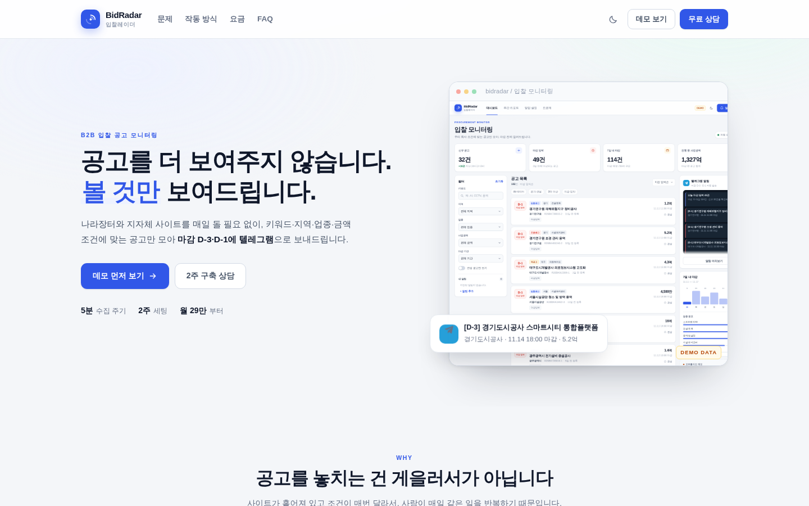
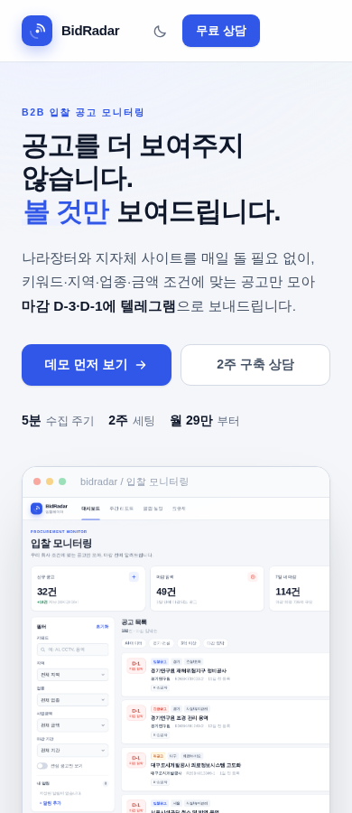
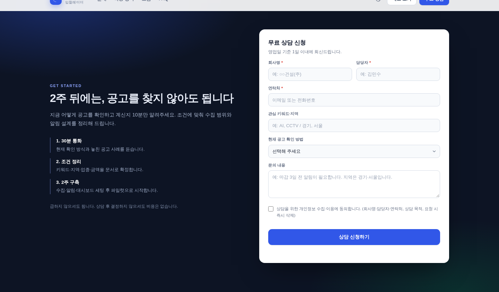
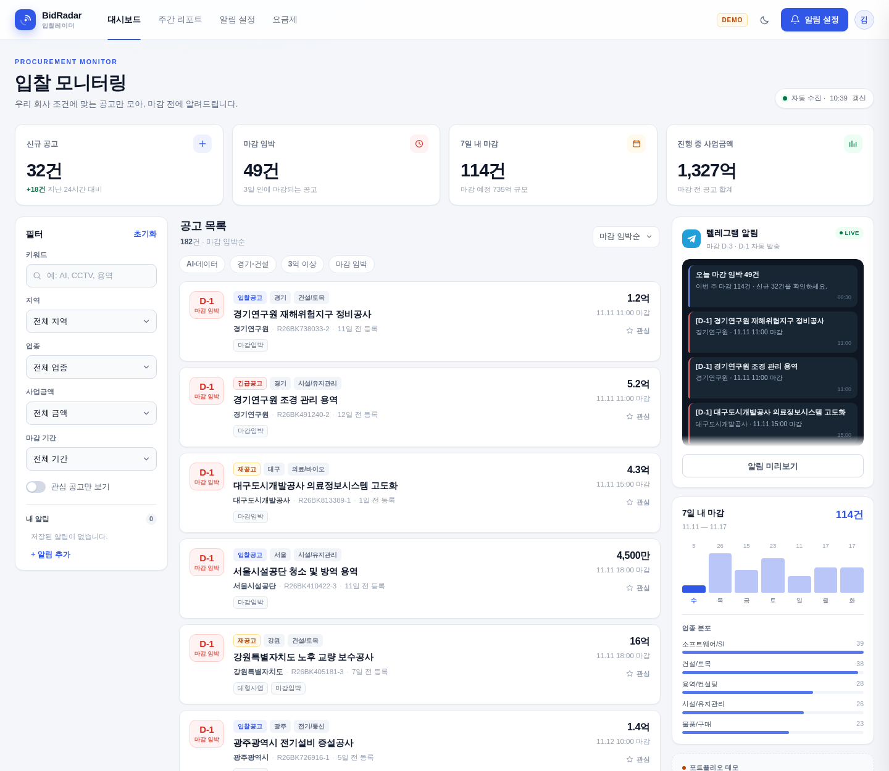
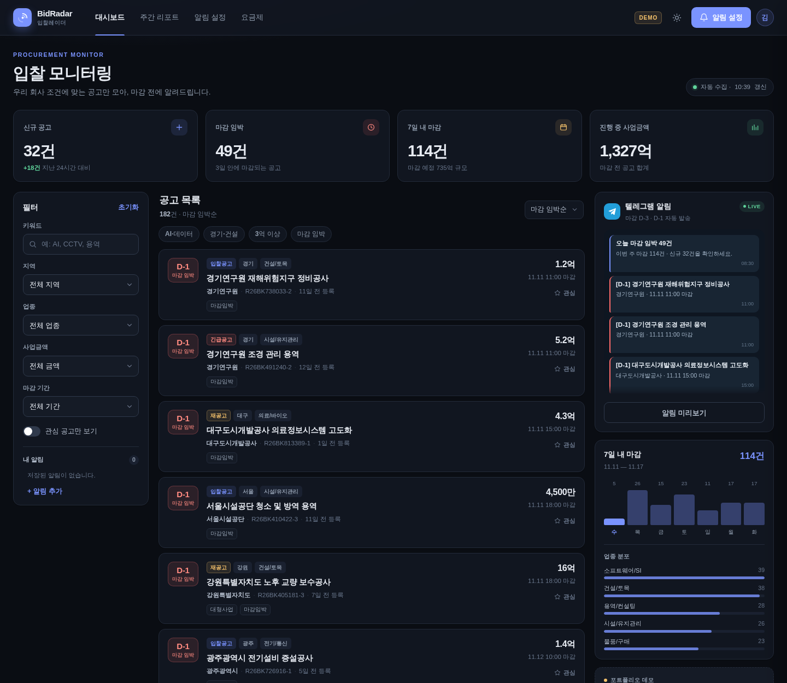
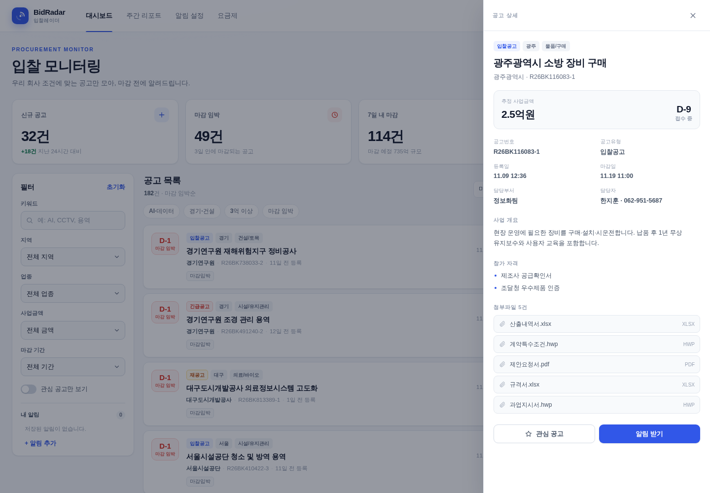
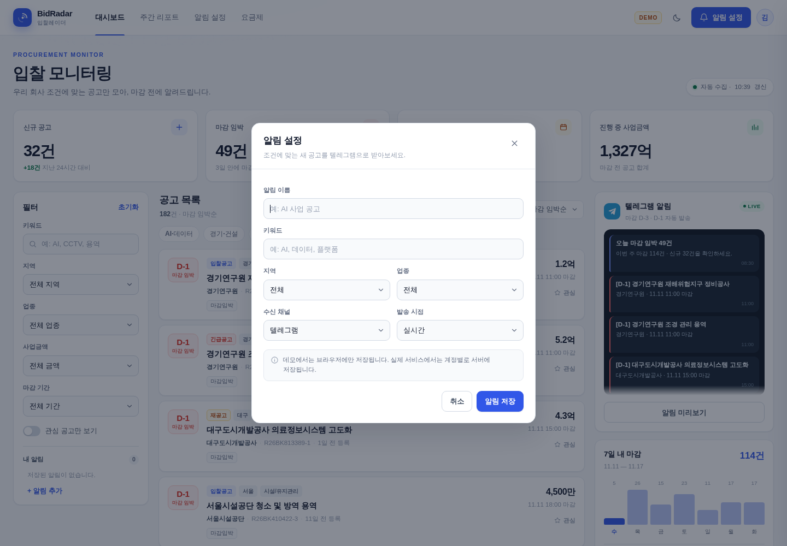
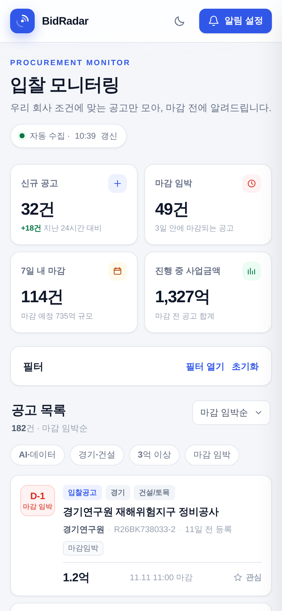

# BidRadar — 입찰 공고 모니터링 대시보드

> 중소기업이 매일 여러 사이트를 돌며 확인하던 입찰 공고를,
> **회사 조건에 맞는 것만 모아 마감 전에 알려주는** B2B 대시보드.

- 라이브 랜딩: <https://bidradar-kr.duckdns.org/>
- 라이브 데모: <https://bidradar-kr.duckdns.org/demo>
- 구성: 랜딩페이지(영업) + 데모 대시보드 + 상담 신청 접수 API

## 문제

입찰 담당자가 없는 중소기업은 담당자가 하루 30분~1시간씩 나라장터와 지자체
사이트를 직접 검색합니다. 조건에 맞는 공고를 놓치면 그대로 매출 기회가 사라지고,
마감 하루 전에 발견하면 준비할 시간이 없습니다.

## 해결

- 17개 시도 + 전국 공공기관 공고를 한 화면에 수집
- 키워드·지역·업종·금액·마감기간으로 즉시 필터링
- D-3, D-1 디스코드·텔레그램 알림과 주간 리포트
- 공고 상세(자격·첨부·담당자)를 클릭 한 번에 확인

## 화면

| 랜딩페이지 | 랜딩 (모바일) | 상담 신청 |
|---|---|---|
|  |  |  |

| 대시보드 (라이트) | 대시보드 (다크) |
|---|---|
|  |  |

| 공고 상세 | 알림 설정 | 모바일 |
|---|---|---|
|  |  |  |

## 구현 포인트

- **백엔드**: Python 표준 라이브러리 `http.server` + SQLite(WAL). 외부 패키지·빌드 없음.
- **프론트엔드**: Vanilla JS. 필터·정렬·페이지네이션·드로어·모달·토스트를 의존성 없이 구현.
- **디자인**: CSS 변수 기반 라이트/다크 테마, 1440/1024/640 반응형, 모바일 필터 접기.
- **랜딩 → 리드**: 상담 폼을 `POST /api/lead`로 접수해 SQLite에 저장, 스팸은 허니팟 + IP당 10분 5건 제한.
- **실데이터 전환**: `collector.py`가 나라장터 입찰공고정보서비스(OpenAPI)를 호출해 `data/live.db`에 적재. `BIDRADAR_SOURCE=live` 한 줄로 데모/실데이터를 전환하고, 실패하면 데모로 되돌릴 수 있음.
- **알림**: 새 상담 신청을 디스코드 웹훅(또는 텔레그램)으로 전송, 미설정 시 로그만, 폼 응답을 막지 않도록 백그라운드 처리.
- **데모 데이터**: 서버 시작 시 190건을 생성하고 2일 뒤 자동 재생성해 마감일이 항상 살아 있음.
- **API 캐시**: 요약 15초 캐시, 요청 경합 방지(race token), 검색 디바운스.
- **배포**: pm2(`127.0.0.1:8790`) + nginx 리버스 프록시 + Let's Encrypt HTTPS, HTTP→HTTPS 리다이렉트.

## 실제 서비스로 전환할 때

현재 나라장터 실데이터 연동과 **고객 공고 알림(D-3/D-1)**까지 완료되어 live 모드로 운영 중입니다
(1만 건 규모 수집, 15분마다 증분 갱신, 알림은 09:00·17:00 발송).

1. ~~조건 매칭 발송 (D-3/D-1), 중복 발송 방지~~ → `alerts.py` + `data/alerts.db`로 구현
2. ~~고객별 조건 관리~~ → `alerts.json` (파일 기반, 파일럿 1~5곳 운영용)
3. **남은 일**: 셀프서비스 가입·과금 (토스페이먼츠·포트원 정기결제)
4. **남은 일**: 고객이 직접 조건을 바꾸는 화면 (현재는 운영자가 파일 수정)
5. **남은 일**: 수집 실패 감지·재시도, 리드 백업

화면·API·랜딩·리드 수집 구조는 그대로 쓸 수 있습니다.
배포·수집 절차는 [`deploy.md`](deploy.md)에 정리해 두었습니다.

## 정직하게 밝힐 점

기관명은 실제 공공기관이지만 **공고 제목·번호·금액·담당자·첨부파일은 모두 가상
데이터**입니다. 포트폴리오/영업 자료에는 "데모 데이터"라고 표기하고, 실적은 실제
고객 사례가 생긴 뒤에만 기재합니다.
